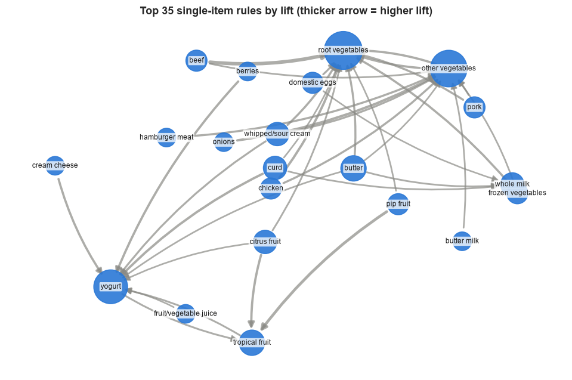
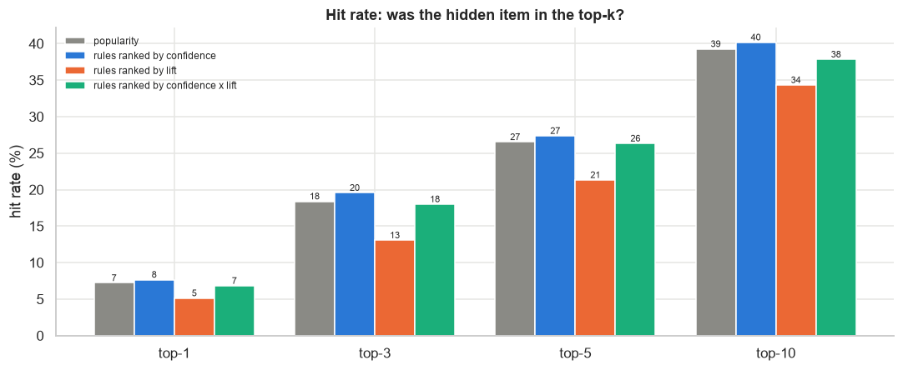
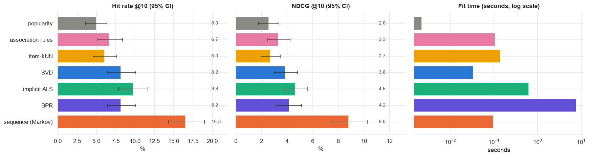

# Recommendation Systems: from Apriori Association Rules to Modern Recommenders

A data science project in two parts: a **grocery recommender built with association rules (Apriori)**, and a companion notebook on **how modern recommenders work** (embeddings, ranking losses, sequence models).

Originally the final project of the *Introduction to Data Science* course (Group 4). The code, analysis and slides have since been rewritten in English and extended.

## Team

| Name | LinkedIn |
|---|---|
| Femi Novia Lina | [linkedin.com/in/feminovialina](https://www.linkedin.com/in/feminovialina/) |
| Cesilia Natasya Nainggolan | [linkedin.com/in/cesiliantsy](https://www.linkedin.com/in/cesiliantsy/) |
| Alya Fitri Nurhaliza | [linkedin.com/in/alyafitrin](https://www.linkedin.com/in/alyafitrin/) |

## What's inside

| Path | What it is |
|---|---|
| [`what-is-apriori.md`](what-is-apriori.md) | 🛒 Beginner-friendly guide: what Apriori is and how it works (start here if you're new) |
| [`notebooks/01-apriori-grocery-recommender.ipynb`](notebooks/01-apriori-grocery-recommender.ipynb) | Part 1: EDA, Apriori, association rules, a ranked recommender, and an honest evaluation against a popularity baseline |
| [`notebooks/02-modern-recommenders-movielens.ipynb`](notebooks/02-modern-recommenders-movielens.ipynb) | Part 2: seven recommenders on MovieLens 100K, from popularity to ALS, BPR and a sequence model, with beyond-accuracy diagnostics |
| [`slides/apriori-recommender-slides-en.pdf`](slides/apriori-recommender-slides-en.pdf) | Project slides, English version (20 slides) |
| [`slides/apriori-recommender-slides-id.pdf`](slides/apriori-recommender-slides-id.pdf) | Original slides, Indonesian |
| [`data/grocery-products-purchase.csv`](data/grocery-products-purchase.csv) | Grocery baskets used in part 1 |

Both notebooks are saved **with their outputs**, so you can read them on GitHub without running anything.

## Part 1: Apriori grocery recommender

**Question:** given the items already in a customer's basket, what should we suggest next?

**Data:** 9,835 baskets and 169 product categories from one month of grocery point-of-sale data.

**Method:** one-hot encode baskets, mine frequent itemsets with Apriori (`min_support` = 1%), derive rules, and rank suggestions by rule confidence. Rules are judged by support, confidence and lift. New to these terms? Read the [friendly Apriori guide](what-is-apriori.md) 🛒.

<p align="center"></p>

**What we found**

- Shopping is concentrated: 20 of 169 items (12%) account for half of all purchases, and 22% of baskets contain a single item.
- Fresh produce (`root vegetables`, `other vegetables`, `tropical fruit`, `yogurt`) drives the strongest rules.
- The 2,824 "duplicate" rows are real repeat baskets, so they are kept.
- **Evaluation (hide one item, predict it):** ranked by confidence, the rules perform **on par with simply recommending best-sellers** (the gap is within sampling noise). Ranking by lift is clearly worse for prediction, because lift favours rare items. Rules are still valuable for **explainability** ("because you bought X") and for discovering associations.

<p align="center"></p>

### What changed from the original notebook

- Translated to English; Colab-only steps (Drive paths, Kaggle API upload) replaced by a local data file, so it runs anywhere.
- Added: basket-size and long-tail analysis, a lift heatmap, a `min_support` sweep, metric explanations, a rule scatter and network, and a train/test evaluation.
- Fixed: the confidence filter was `>= 0.015`, which kept almost every rule; the old `find()` returned an unranked list (45 items for a single-item basket), now complemented by a ranked `recommend()`; removed no-op and broken cells.

## Part 2: how modern recommenders work

Association rules know nothing about *who* the user is or *in what order* they acted. Notebook 02 builds, from scratch with `numpy`, the main ideas behind current systems, on [MovieLens 100K](https://grouplens.org/datasets/movielens/100k/) (943 users, 1,682 movies):

popularity · association rules · item-kNN · SVD · implicit ALS · BPR · a sequence (Markov) model

Evaluation is deliberately strict: time-based leave-one-out, full ranking over all unseen movies, validation-only tuning, and bootstrap 95% confidence intervals.

<p align="center"></p>

**What we found**

- Learned models beat popularity only modestly on this small dataset; SVD, ALS and BPR are statistically tied.
- **Order is the big effect:** a tiny Markov chain over "what users watched next" scored about 16.5% HR@10, versus about 9.8% for the best non-sequential model, with non-overlapping confidence intervals.
- Every model is far better at predicting blockbusters than niche movies (the long-tail and item cold-start problem).
- Includes an embedding map, nearest-neighbour examples, popularity-bias, coverage and diversity checks, and a section placing these building blocks in today's landscape (two-tower retrieval, sequential transformers, generative retrieval).

Runs in about a minute on a laptop CPU (no GPU).

## Run it yourself

```bash
git clone https://github.com/cesinata/Recommendation-System-using-Apriori-Algorithm.git
cd Recommendation-System-using-Apriori-Algorithm

python3 -m venv .venv
source .venv/bin/activate
pip install -r requirements.txt

jupyter notebook notebooks/
```

Open a notebook and choose **Run → Run All Cells**. Run notebooks from inside the `notebooks/` folder (they use relative paths). Notebook 02 downloads MovieLens 100K (about 5 MB) on first run.

## Data sources and licences

- **Grocery Products Purchase** ([Kaggle, AlexMiles](https://www.kaggle.com/alexmiles/grocery-products-purchase-data)): the *Groceries* dataset from the R package [`arules`](https://search.r-project.org/CRAN/refmans/arules/html/Groceries.html). Kaggle lists the data files as © the original authors. Original reference: Hahsler, M., Hornik, K. & Reutterer, T. (2006). *Implications of probabilistic data modeling for mining association rules.* In *From Data and Information Analysis to Knowledge Engineering*, Springer, pp. 598–605.
- **MovieLens 100K** ([GroupLens](https://grouplens.org/datasets/movielens/100k/)): Harper, F. M. & Konstan, J. A. (2015). *The MovieLens Datasets: History and Context.* ACM TiiS 5(4). [doi:10.1145/2827872](https://doi.org/10.1145/2827872). GroupLens does not allow redistributing the data without permission, so it is **not** stored in this repo; the notebook downloads it from GroupLens.

## Key references

- Agrawal & Srikant (1994). *Fast algorithms for mining association rules.* VLDB.
- Rendle et al. (2009). *BPR: Bayesian personalized ranking from implicit feedback.* [arXiv:1205.2618](https://arxiv.org/abs/1205.2618)
- Kang & McAuley (2018). *Self-attentive sequential recommendation (SASRec).* [arXiv:1808.09781](https://arxiv.org/abs/1808.09781)
- Rajput et al. (2023). *Recommender systems with generative retrieval (TIGER).* [arXiv:2305.05065](https://arxiv.org/abs/2305.05065)
- Zhai et al. (2024). *Actions speak louder than words: Trillion-parameter sequential transducers for generative recommendations (HSTU).* [arXiv:2402.17152](https://arxiv.org/abs/2402.17152)
- Dacrema et al. (2019). *Are we really making much progress?* [arXiv:1907.06902](https://arxiv.org/abs/1907.06902)
- Rendle et al. (2020). *Neural collaborative filtering vs. matrix factorization revisited.* [arXiv:2005.09683](https://arxiv.org/abs/2005.09683)

The full reference list is at the end of notebook 02.

## Original deployment and dashboard

The original project also shipped a small Streamlit app (pick up to two items, get suggestions) and an exploratory Google Data Studio dashboard. They are linked from the slides; they are third-party hosted and may no longer be online.

- Streamlit app: <https://feminovialina-simple-apriori-recommendation-system-d-app-93n7sm.streamlit.app/>
- Dashboard: <https://datastudio.google.com/reporting/5bcdc6f8-d0a5-42ae-b76d-91433869be18>
